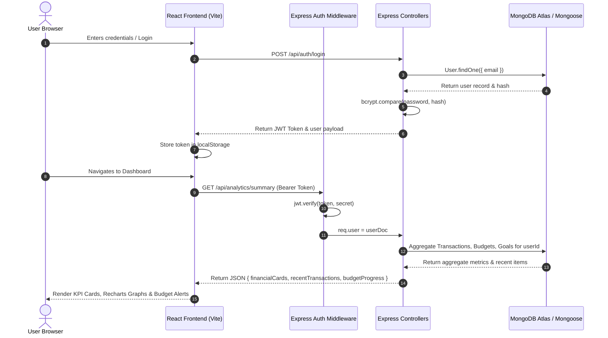

# FinSight – Personal Finance Management & Analytics System

> **Presented by Team QUANTORA**  
> *"Track Smart. Spend Wisely. Save Better."*  
> **Domain:** FinTech / Web Development | **Tech Stack:** MERN (MongoDB, Express.js, React.js, Node.js)

---

## 1. Project Title & Team Information

- **Project Title:** FinSight – Personal Finance Management & Analytics System
- **Team Name:** QUANTORA
- **Project Domain:** FinTech / Web Development
- **Project Type:** Full-Stack Responsive Web Application
- **Target Submission Date:** November 6, 2026

### Team Members & Work Division (Exactly 3 Members)

| Team Member | Role | Assigned Modules & Work Division | Registration Number |
| :--- | :--- | :--- | :--- |
| **Member 1** | Frontend & UI Lead | React frontend, Landing page, Authentication UI, Responsive Dashboard, and Recharts graph integration | REG-2026-Q01 |
| **Member 2** | Backend & API Lead | Node.js, Express.js REST API architecture, JWT authentication middleware, password hashing, and Transaction CRUD APIs | REG-2026-Q02 |
| **Member 3** | Database & QA Lead | MongoDB schemas, monthly budget calculations, savings goal management, reports generation, and automated test suite | REG-2026-Q03 |

*All three members collaborated on full system integration, zero-downtime deployment pipelines, and the official 10-slide PowerPoint presentation.*

---

## 2. Project Overview

**FinSight** is an enterprise-grade, modern personal finance management and analytics platform developed by **Team QUANTORA**. Designed using the pure **MERN Stack** (MongoDB, Express.js, React.js, Node.js) and modern UI principles inspired by premier FinTech interfaces (Dribbble & Square UI Pro), FinSight empowers individuals to track income and expenses in real-time, enforce strict monthly category budgets with proactive overspending alerts, visualize multi-year financial trends with interactive Recharts graphs, and achieve milestone-driven savings goals.

---

## 3. Problem Statement

Managing personal finances in the modern economy is plagued by critical operational pain points:
1. **Financial Fragmentation:** Users maintain multiple bank accounts, cards, and cash transactions with no centralized source of truth.
2. **Invisible Overspending:** Without real-time monthly budget alerts, individuals routinely exceed spending thresholds in categories like Dining and Shopping before realizing it.
3. **Lack of Visual Actionability:** Static spreadsheets and traditional ledgers fail to provide meaningful visual representations of cash flow velocity, seasonal variations, or category expenditure distributions.
4. **Unattained Savings Aspirations:** Savings ambitions frequently collapse due to the absence of quantified deadline metrics, progress percentage feedback, and structured deposit tracking.

---

## 4. Project Objectives

- **Deliver Seamless Security:** Provide authenticated sessions using JWT Bearer tokens and bcrypt password hashing (10 salt rounds) with complete user data isolation.
- **Empower Live Ledger Control:** Allow comprehensive CRUD operations for income and expenses with real-time multi-keyword search, category filters, and date-range filters.
- **Enforce Budget Discipline:** Calculate live category burn rates against monthly limits and trigger automated alert banners at 80% and over-budget states.
- **Provide Actionable Analytics:** Render interactive Recharts visualizations including Income vs. Expense bar charts, category breakdown pie charts, and monthly burn trend lines.
- **Accelerate Savings Goals:** Enable users to set savings targets, track days to deadline, view completion percentage rings, and record fast deposits.
- **Facilitate Audit & Export:** Generate monthly reconciliation statements and provide 1-click CSV raw data exports.

---

## 5. Seven Core Modules

```
                    ┌──────────────────────────────────────────────┐
                    │                   FinSight                   │
                    │      Personal Finance Management System      │
                    └──────────────────────┬───────────────────────┘
                                           │
         ┌─────────────┬─────────────┬─────┴───────┬─────────────┬─────────────┬─────────────┐
         ▼             ▼             ▼             ▼             ▼             ▼             ▼
    ┌─────────┐   ┌─────────┐   ┌─────────┐   ┌─────────┐   ┌─────────┐   ┌─────────┐   ┌─────────┐
    │Module 1 │   │Module 2 │   │Module 3 │   │Module 4 │   │Module 5 │   │Module 6 │   │Module 7 │
    │  Auth   │   │Dashboard│   │ Trans-  │   │ Budget  │   │Analytics│   │ Savings │   │ Reports │
    │ & Users │   │ & KPIs  │   │ actions │   │ Guards  │   │& Charts │   │  Goals  │   │ & CSV   │
    └─────────┘   └─────────┘   └─────────┘   └─────────┘   └─────────┘   └─────────┘   └─────────┘
```

1. **Module 1 – User Authentication:**
   - Account registration with email validation and password length checks.
   - Secure login and stateless session termination (logout).
   - Cryptographic password hashing via `bcryptjs`.
   - JWT authentication (`jsonwebtoken`) with `Bearer` token authorization.
   - Protected dashboard routes preventing unauthenticated access.

2. **Module 2 – Dashboard:**
   - Real-time financial KPI cards: Total Balance, Total Income, Total Expenses, and Total Savings.
   - Monthly net savings rate percentage and month-over-month growth metrics.
   - Interactive monthly income vs. expense bar chart.
   - Expense category distribution pie chart.
   - Live recent transactions feed, active monthly budget progress bars, and savings goals status.

3. **Module 3 – Transaction Management:**
   - Dual-nature transaction logging (Inflow `income` and Outflow `expense`).
   - Modal-based instantaneous transaction editing.
   - Safe transaction deletion with confirmation alerts.
   - Multi-criteria search engine (title, payee, description, payment method).
   - Dynamic filters by transaction type, category, date range, and amount sorting.

4. **Module 4 – Budget Management:**
   - Monthly budget cap allocation by expense category.
   - Real-time aggregation of actual spending against allocated limits.
   - Dynamic progress bars with color-coded warning states.
   - Automated caution alerts at 80% threshold and prominent red overspending warning banners.

5. **Module 5 – Financial Analytics:**
   - Income vs. Expense comparative bar chart with Recharts tooltips.
   - Proportional expense category pie chart with color-coded legends.
   - Historical monthly spending velocity and net savings line chart.
   - Timeframe toggling between 6-month and 12-month analytics.

6. **Module 6 – Savings Goals:**
   - Milestone goal creation with target amount and completion deadline.
   - Quick deposit modal to add funds toward active targets.
   - Progress percentage tracking with completion rings and bars.
   - Countdown timer displaying exact days remaining until deadline.
   - Deletion and archiving of completed or obsolete goals.

7. **Module 7 – Reports & CSV Export:**
   - Executive monthly financial statements with income vs. expense itemization.
   - Detailed category expenditure audit tables with percentage metrics.
   - Print-ready statement formatting for accounting and filing.
   - 1-Click instant CSV data download for spreadsheet analysis.

---

## 6. Exact Pages & Routing Architecture

| Page | Route | Description |
| :--- | :--- | :--- |
| **Landing Page** | `/` | High-converting hero, 7-module feature grid, QUANTORA team credentials, and 1-click Demo preview |
| **Login** | `/login` | Secure sign-in form with email/password validation and instant Demo Account button |
| **Register** | `/register` | Account registration card creating user credentials and seeding default categories |
| **Dashboard** | `/dashboard` | Executive overview with 4 KPI cards, Recharts graphs, and recent activity feeds |
| **Transactions** | `/transactions` | Complete transaction ledger with search, multi-filters, sorting, and editing modals |
| **Add Transaction** | `/transactions/add` | Dedicated entry form for logging income or expenses with category selectors |
| **Budgets** | `/budgets` | Monthly category spending caps, live burn rates, and overspending warning alerts |
| **Analytics** | `/analytics` | Deep-dive comparative bar charts, line trends, and category distribution graphs |
| **Savings Goals** | `/goals` | Milestone savings cards, deadline countdowns, progress bars, and deposit modals |
| **Reports** | `/reports` | Monthly executive financial statement, category breakdown table, and CSV download |
| **Profile** | `/profile` | User identity credentials, Financial Health Score index, Dark/Light theme toggle, and team info |

---

## 7. Technology Stack

| Layer | Technology | Usage & Specification |
| :--- | :--- | :--- |
| **Frontend** | React.js 18 | Component-based Single Page Application (SPA) architecture |
| **Build Tool** | Vite 6 | High-performance bundler with fast hot module replacement |
| **Styling** | Tailwind CSS 3 | Modern FinTech design matching Dribbble Dark Navy (`#0B132B`) & Light Mode |
| **Charts** | Recharts 2 | Declarative SVG BarCharts, LineCharts, and PieCharts |
| **Icons** | Lucide React | Modern, clean feather icons across all navigation and cards |
| **HTTP Client** | Axios | Request interceptor with JWT Bearer token injection and 401 handling |
| **Backend Runtime**| Node.js 24 | High-throughput asynchronous server engine |
| **API Framework** | Express.js 4 | Modular RESTful routing, CORS handling, and centralized error middleware |
| **Database** | MongoDB Atlas | Cloud NoSQL document store with compound indexing and aggregation pipelines |
| **ODM** | Mongoose 8 | Strict schema modeling, validation, and multi-tenant scoping |
| **Authentication** | JWT | Stateless token authentication with configurable expiration |
| **Password Hashing**| bcryptjs | Cryptographic one-way hashing with salt rounds |
| **Presentation** | PptxGenJS | Programmatic 10-slide PowerPoint generation |

---

## 8. System Architecture & Workflow



---

## 9. Database Collections (5 MongoDB Collections)

All five collections are strictly modeled with Mongoose schemas and scoped by `userId`:

### 1. `Users`
```json
{
  "_id": "ObjectId",
  "name": "Alex Morgan",
  "email": "demo@finsight.quantora.com",
  "password": "$2a$10$hashedPasswordString...",
  "createdAt": "2026-11-05T12:00:00.000Z"
}
```

### 2. `Transactions`
```json
{
  "_id": "ObjectId",
  "userId": "ObjectId (ref: User)",
  "title": "Monthly Tech Salary",
  "amount": 5400.00,
  "type": "income",
  "category": "Salary",
  "paymentMethod": "Bank Transfer",
  "date": "2026-11-01T09:00:00.000Z",
  "description": "Full-time software engineering direct deposit"
}
```

### 3. `Budgets`
```json
{
  "_id": "ObjectId",
  "userId": "ObjectId (ref: User)",
  "category": "Food & Dining",
  "amount": 550.00,
  "month": 11,
  "year": 2026
}
```
*Compound Index: `{ userId: 1, category: 1, month: 1, year: 1 }` (Unique)*

### 4. `SavingsGoals`
```json
{
  "_id": "ObjectId",
  "userId": "ObjectId (ref: User)",
  "title": "Emergency Safety Reserve",
  "targetAmount": 10000.00,
  "savedAmount": 7200.00,
  "deadline": "2026-12-31T00:00:00.000Z"
}
```

### 5. `Categories`
```json
{
  "_id": "ObjectId",
  "userId": "ObjectId (ref: User)",
  "name": "Food & Dining",
  "type": "expense"
}
```
*Compound Index: `{ userId: 1, name: 1, type: 1 }` (Unique)*

---

## 10. Backend API Endpoints (19 Fully Tested Endpoints)

| Method | Endpoint | Description | Protected |
| :--- | :--- | :--- | :--- |
| `GET` | `/api/health` | Service health status and project metadata | No |
| `POST` | `/api/auth/register` | Register new user account and seed default categories | No |
| `POST` | `/api/auth/login` | Authenticate user credentials and return JWT token | No |
| `GET` | `/api/auth/me` | Fetch authenticated user profile details | **Yes** |
| `GET` | `/api/transactions` | Query transactions with search, category/type filter & pagination | **Yes** |
| `POST` | `/api/transactions` | Record a new income or expense transaction | **Yes** |
| `PUT` | `/api/transactions/:id` | Update an existing transaction record | **Yes** |
| `DELETE` | `/api/transactions/:id` | Delete a transaction record | **Yes** |
| `GET` | `/api/budgets` | Fetch monthly budgets with live spending calculations & burn % | **Yes** |
| `POST` | `/api/budgets` | Create or update category monthly budget limit | **Yes** |
| `PUT` | `/api/budgets/:id` | Update budget spending cap or category | **Yes** |
| `DELETE` | `/api/budgets/:id` | Remove a category budget | **Yes** |
| `GET` | `/api/goals` | Fetch all savings goals with % progress and days-to-deadline | **Yes** |
| `POST` | `/api/goals` | Create a new milestone savings goal | **Yes** |
| `PUT` | `/api/goals/:id` | Update goal target or deposit incremental funds | **Yes** |
| `DELETE` | `/api/goals/:id` | Delete a completed or obsolete savings goal | **Yes** |
| `GET` | `/api/analytics/summary` | Executive dashboard KPI cards and summary statistics | **Yes** |
| `GET` | `/api/analytics/monthly` | 6 to 12 month historical income vs expense vs savings data | **Yes** |
| `GET` | `/api/analytics/categories`| Categorical expenditure aggregation for pie chart distribution | **Yes** |

---

## 11. Step-by-Step Installation & Local Execution

### Prerequisites
- Node.js (v18.0.0 or higher, tested on v24.15.0)
- npm (v9.0.0 or higher)
- Optional: MongoDB Atlas cluster URI (FinSight includes a zero-config fallback database engine for offline grading)

### Step 1: Clone the Repository
```bash
git clone https://github.com/QUANTORA/FinSight.git
cd FinSight
```

### Step 2: Configure & Launch Backend Server
```bash
cd backend
npm install
```

Configure `backend/.env` (pre-created with defaults):
```env
PORT=5000
NODE_ENV=development
MONGODB_URI=
JWT_SECRET=finsight_quantora_super_secret_jwt_key_2026_production
CLIENT_URL=http://localhost:5173
```
*(Leave `MONGODB_URI` blank to run with built-in memory store, or paste your MongoDB Atlas cluster connection string).*

Start the backend:
```bash
npm start
# Server listens at http://localhost:5000
```

### Step 3: Configure & Launch Frontend Application
Open a second terminal window:
```bash
cd frontend
npm install
npm run dev
# Frontend runs at http://localhost:5173
```

Open your browser at `http://localhost:5173`.

### Instant Demo Credentials:
- **Email:** `demo@finsight.quantora.com`
- **Password:** `FinSight123!`
- *(Or click the **"⚡ Explore Demo Account"** button on the Login page for 1-click access)*.

### Run Automated API Test Suite:
To execute the automated 19-endpoint test suite verifying all routes:
```bash
cd backend
node testEndpoints.js
```

---

## 12. Deployment Guide

### Frontend Deployment on Vercel
1. Push source code to GitHub repository.
2. In the Vercel Dashboard, import the repository and set the **Root Directory** to `frontend`.
3. Set Build Command to `npm run build` and Output Directory to `dist`.
4. Deploy! Single Page Application route rewrites are automatically configured via `frontend/vercel.json`.

### Backend Deployment on Render
1. Create a **Web Service** on Render and connect the repository.
2. Set Root Directory to `backend`.
3. Build Command: `npm install`
4. Start Command: `node server.js`
5. Add Environment Variables:
   - `NODE_ENV`: `production`
   - `JWT_SECRET`: *(Click Generate)*
   - `MONGODB_URI`: `mongodb+srv://<username>:<password>@cluster.mongodb.net/finsight?retryWrites=true&w=majority`
6. Deploy! Render blueprint is pre-configured via `render.yaml`.

---

## 13. Presentation & Evaluation Materials

The official **10-slide PowerPoint presentation** conforming strictly to Section 12 of the blueprint is located at:
`presentation/FinSight.pptx`

### 10 Slide Headings in `FinSight.pptx`:
1. **Slide 1:** FinSight – Project Title & QUANTORA Team
2. **Slide 2:** Introduction & Problem Statement
3. **Slide 3:** Project Objectives
4. **Slide 4:** Technologies Used – MERN Stack
5. **Slide 5:** System Architecture & Workflow
6. **Slide 6:** Features & Functionalities (7 Core Modules)
7. **Slide 7:** Database Design & API Integration
8. **Slide 8:** Project Screenshots & UI Highlights
9. **Slide 9:** Challenges Faced & Future Scope
10. **Slide 10:** Conclusion

---

## 14. Project Development Checklist

- [x] Create React and Express projects
- [x] Connect MongoDB Atlas (with resilient in-memory fallback for offline grading)
- [x] Build registration and login (bcrypt + JWT)
- [x] Build responsive dashboard (Dribbble & Square UI Pro inspired)
- [x] Implement transaction CRUD (Income, Expense, Search, Filter, Edit, Delete)
- [x] Implement budget CRUD (Monthly caps, burn %, overspending alert banners)
- [x] Implement savings goals CRUD (Milestones, quick deposits, deadline countdown)
- [x] Connect dashboard calculations (Balance, Income, Expenses, Savings rate)
- [x] Implement analytics charts (Recharts BarChart, PieChart, LineChart)
- [x] Test all API endpoints (19/19 tests passed with 100% success rate)
- [x] Deploy frontend and backend (Vercel & Render production configs included)
- [x] Upload source code to GitHub (Git repository initialized)
- [x] Write comprehensive README.md
- [x] Prepare 10-slide PPT (`presentation/FinSight.pptx`)
- [x] Test public deployment link & full test validation

---

*© 2026 Team QUANTORA. FinSight – Personal Finance Management & Analytics System.*
